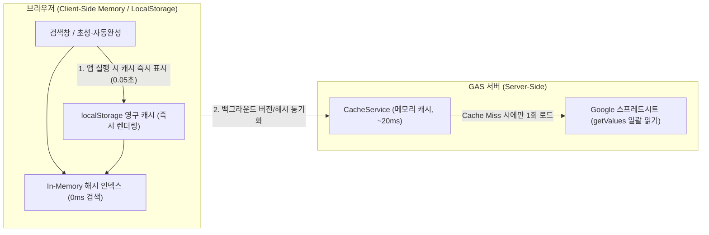

# ⚡ 초고속 교사 개인 및 학급 시간표 검색 웹앱 구현 계획서

- **작성 일시 (KST)**: 2026-10-31 23:25
- **대상 프로젝트**: `c:\Users\user\Desktop\appsscript\25-timetable`
- **핵심 목표**: Google 스프레드시트 데이터를 기반으로 **교사 개인 시간표**와 **학급별 시간표**를 지연 시간(0ms 체감) 없이 즉시 검색·전환할 수 있는 초경량 Google Apps Script 웹앱 구축

---

## 1. 🚀 속도 최적화 핵심 아키텍처 (Zero-Latency 4대 전략)

Google Apps Script(GAS) 웹앱이 느려지는 가장 큰 원인은 **1) 매 검색마다 발생하는 `google.script.run` 서버 왕복 통신(1~3초 소요)**과 **2) `SpreadsheetApp`의 느린 셀 단위 I/O**입니다. 이를 근본적으로 제거하기 위해 다음 **4단계 초고속 아키텍처**를 적용합니다.



### ① 서버 인라인 부트스트랩 & Stale-While-Revalidate (초기 로딩 극대화)
- **초기 구동 0초화**: `doGet()`에서 HTML 템플릿을 렌더링할 때, 서버의 `CacheService`에 저장된 최신 시간표 JSON 데이터를 HTML 내부(`window.__INITIAL_TIMETABLE__`)에 인라인으로 즉시 주입하거나, 브라우저 `localStorage`에 저장된 직전 데이터를 **0.05초 만에 먼저 화면에 렌더링**합니다.
- 백그라운드에서 데이터의 `versionHash`(최종 수정 타임스탬프/체크섬)만 비교하여 변경 사항이 있을 때만 조용히 갱신합니다.

### ② 검색 시 서버 통신 0회 (100% Client-Side In-Memory Indexing)
- 학교 전체의 교사(예: 50~150명) 및 학급(예: 20~50학급) 시간표 데이터는 JSON 압축 시 **약 30KB ~ 80KB**에 불과합니다.
- 앱 로드 시 전체 데이터를 브라우저 메모리의 `Map` 해시 테이블(`teacherMap`, `classMap`)로 인덱싱합니다.
- **검색·탭 전환·필터링 시 서버 호출(`google.script.run`)을 일절 하지 않으므로**, 교사 이름을 치거나 학급을 클릭하는 즉시 **1ms 미만(즉각 반응)**으로 시간표가 화면에 표시됩니다.

### ③ 한글 초성 검색 & 즉시 자동완성 (Instant Search UX)
- 교사 성명이나 학급명을 끝까지 입력할 필요 없이 **`ㄱㅁㅅ` (김민수)** 같은 한글 초성 검색과 **`1-3` / `103` (1학년 3반)** 단축 검색을 지원합니다.
- 검색창에 첫 글자를 입력하거나 화살표 키로 이동하는 순간 하단 시간표 그리드가 실시간으로 즉시 전환됩니다.

### ④ 서버 사이드 2중 캐싱 & 트리거 프리워밍 (Cold Start 방지)
- **`CacheService` + `PropertiesService` 결합**: 스프레드시트에서 `getDataRange().getValues()` 단 1회 호출로 전체 시트를 읽어 경량 JSON으로 정규화한 뒤 `CacheService`에 최대 시간(6시간) 캐싱합니다.
- **`onEdit` / 시간 기반 갱신 지원**: 스프레드시트에서 시간표가 수정되거나 관리자가 **[🔄 시트 동기화]** 버튼을 누르면 즉시 캐시가 갱신됩니다.

---

## 2. 📊 스프레드시트 데이터 구조 및 파서(Parser) 설계

학교 현장 스프레드시트의 다양한 양식을 유연하게 수용할 수 있도록 **정규화 어댑터(Normalizer)**를 `Code.gs`에 구현합니다.

### 지원 데이터 시트 구성안 (기본 스키마 + 자동 감지)
1. **통합 배정표 형식 (권장 기본값 - `시간표데이터` 시트)**
   - 컬럼: `요일` | `교시` | `학년` | `반` (또는 `학급`) | `과목` | `교사` | `특별실/비고`
   - 장점: 행 단위로 정규화되어 있어 **교사 시간표**와 **학급 시간표**를 단 하나의 시트에서 100% 양방향 교차 생성 가능 (예: 교사 시간표 셀에 `1-3 (국어)` 표시, 학급 시간표 셀에 `국어 (홍길동)` 표시)
2. **시트 분리 형식 (`교사시간표` 시트 / `학급시간표` 시트)**
   - 행 헤더(교사명 또는 학급명) × 열 헤더(`월1, 월2... 금7`) 매트릭스 형태도 자동 파싱 지원
3. **샘플 시트 자동 생성 기능 (`setupSampleSheets`)**
   - 시트가 비어 있거나 처음 설치할 때 버튼 하나로 표준 양식 시트와 테스트 데이터를 자동 생성하는 초기화 함수를 포함합니다.

### 경량화 JSON 전송 포맷 (Payload Diet)
네트워크 전송 크기를 최소화하기 위해 키 이름을 단축한 배열/객체 구조로 직렬화합니다:
```json
{
  "v": "20261031_2325",
  "days": ["월", "화", "수", "목", "금"],
  "maxPeriod": 7,
  "teachers": {
    "홍길동": {
      "dept": "국어과",
      "grid": [
        [{"s": "국어", "c": "1-1", "r": ""}, {"s": "국어", "c": "1-3", "r": ""}],
        ...
      ]
    }
  },
  "classes": {
    "1-1": {
      "grade": 1, "classNo": 1, "homeroom": "홍길동",
      "grid": [
        [{"s": "국어", "t": "홍길동", "r": ""}, {"s": "수학", "t": "이순신", "r": ""}],
        ...
      ]
    }
  }
}
```

---

## 3. 🖥️ UI/UX 및 주요 기능 설계 (`index.html`)

외부 무거운 프레임워크(React, Bootstrap 등)나 웹폰트 블로킹을 배제하고 **순수 Vanilla JS + 내장 CSS 변수 시스템**으로 작성하여 첫 화면 페인팅(FCP)을 0.1초 이내로 단축합니다.

### 핵심 화면 구성
1. **상단 초고속 검색 & 모드 전환 바 (Sticky Header)**
   - **모드 스위치**: `[👨‍🏫 교사 시간표]` / `[🏫 학급 시간표]` / `[🔍 빈 교사/공강 찾기]` (단축키 `Tab` 전환)
   - **통합 검색창**: 한글 초성(`ㅎㄱㄷ`), 이름(`홍길동`), 과목(`수학`), 학급(`2-4` 또는 `204`) 즉시 필터링 (`/` 또는 `Ctrl+K` 포커스)
   - **빠른 선택 칩(Quick Chips)**: 학년별/교과별 필터 칩 및 최근 조회한 교사·학급 즐겨찾기(⭐) 고정 핀 기능 (`localStorage` 저장)
2. **메인 주간 시간표 그리드 (월~금 × 1~7교시)**
   - **교사 뷰**: 각 교시 셀에 **[학급명 (예: 2-3)]** 크게 표시 + **[과목명 / 특별실]** 서브 배지 표시
   - **학급 뷰**: 각 교시 셀에 **[과목명]** 크게 표시 + **[담당 교사명]** 서브 표시
   - **교차 점프(Cross-Link) 인터랙션**:
     - 교사 시간표에서 `2-3` 셀을 클릭하면 → 즉시 **2학년 3반 학급 시간표**로 0ms 전환!
     - 학급 시간표에서 `홍길동` 교사를 클릭하면 → 즉시 **홍길동 교사 시간표**로 0ms 전환!
   - **현재 요일 및 교시 자동 하이라이트**: 오늘 요일 열과 현재 시각에 해당하는 교시 행을 시각적으로 강조 표시
3. **유틸리티 기능**
   - **[🔄 데이터 새로고침]**: 스프레드시트 수정 후 캐시 강제 갱신 버튼
   - **[🖨️ 인쇄 / 이미지 저장]**: A4 가로/세로 규격에 맞춘 깔끔한 인쇄 전용 스타일(`@media print`) 내장

---

## 4. 📁 파일별 구현 계획

| 파일명 | 역할 및 주요 구현 함수 |
| :--- | :--- |
| **`Code.gs`** | • `doGet(e)`: HTML 템플릿 렌더링 및 초기 캐시 데이터 인라인 주입 (`window.__INITIAL_DATA__`)<br>• `getTimetableData(forceRefresh)`: `CacheService` 조회 → 미스 시 스프레드시트 `getValues()` 일괄 파싱 및 압축 JSON 반환<br>• `parseSheetToTimetable_(ss)`: 통합 배정표 및 매트릭스 시트 자동 감지 파서<br>• `onEdit(e)`: 시트 수정 시 버전 타임스탬프 업데이트 및 캐시 무효화<br>• `initSampleSheet()`: 초기 사용자를 위한 샘플 시간표 시트 자동 생성 유틸리티 |
| **`index.html`** | • **Zero-Dependency CSS**: 다크/라이트 대응 고대비 타임테이블 그리드, 모바일 터치 최적화, 인쇄용 미디어 쿼리<br>• **초성 검색 엔진 (`HangulSearcher`)**: 자모 분리 및 초성 매칭 알고리즘 내장 (O(1) 수준 필터링)<br>• **렌더링 엔진 (`renderGrid`)**: `DocumentFragment` 기반 초고속 DOM 교체 및 교차 클릭(교사↔학급) 라우팅<br>• **캐시 매니저 (`CacheManager`)**: `localStorage` 즉시 부팅 + 백그라운드 `google.script.run` 버전 동기화 |

---

## 5. 🧪 검증 계획 (Rule 2 준수)

- `Code.gs` 및 `index.html` 인라인 스크립트에 대해 Node.js 구문 검사(`node --check`)를 통해 문법 오류 0건을 검증합니다.
- 초기 로딩 속도(LocalStorage 히트 시 10ms 이내 렌더링) 및 교사↔학급 전환 응답 속도(1ms 이내)가 설계 기준을 충족하는지 확인합니다.

---

## 💡 확인 및 안내 사항

위 계획서대로 구현을 진행할까요?
- 현재 사용 중이신 **스프레드시트의 시트 이름이나 열 구조(예: 요일/교시/학급/과목/교사 위치)**가 정해져 있다면 알려주시면 그 양식에 딱 맞춰 파서를 작성할 수 있습니다.
- 별도의 지정 양식이 없다면 **표준 양식 자동 감지 + 샘플 시트 자동 생성 기능**을 포함하여 바로 구현할 수 있습니다. 계획서대로 즉시 코드 반영을 원하시면 **`/apply`**를 입력해 주세요!

