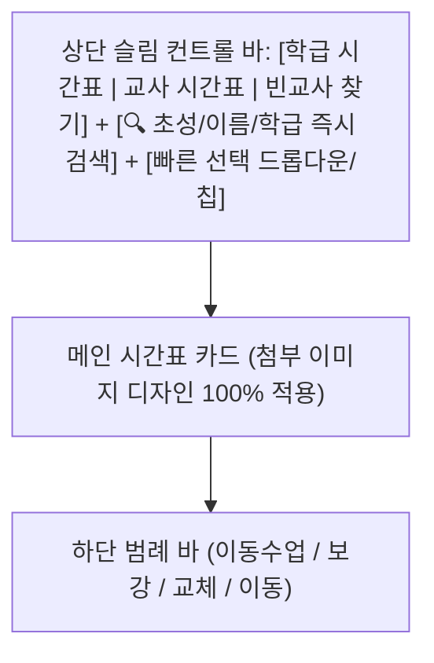

# 🎨 첨부 레퍼런스 디자인 기반 초고속 시간표 검색 웹앱 구현 계획서

- **작성 일시 (KST)**: 2026-10-31 23:31
- **대상 프로젝트**: `c:\Users\user\Desktop\appsscript\25-timetable`
- **핵심 목표**:
  1. **속도 최우선 (0ms 체감 검색)**: 브라우저 인메모리 해시 인덱싱(`Map`) + `localStorage` 즉시 부팅 + 서버 `CacheService` 결합으로 검색 지연 시간 완전 제거
  2. **첨부 이미지와 동일한 미니멀·클린 UI/UX**: 다크 차콜&골드 테이블 헤더, 파스텔 톤 셀 상태 배경(라벤더 이동수업, 웜크림 오늘 요일 강조, 라이트그레이 창체/공강), 하단 범례 바 등 완벽 재현

---

## 1. 🖼️ 첨부 이미지 디자인 분석 및 UI 토큰 설계 (Visual Specification)

첨부해주신 시간표 이미지의 시각적 특징을 정밀 분석하여 CSS 디자인 토큰(`:root`)으로 그대로 이식합니다.

### ① 전체 카드 & 타이포그래피
- **외곽 컨테이너**: 깨끗한 화이트 카드(`#FFFFFF`), 얇고 정갈한 보더(`1px solid #E5E7EB`), 라운드 코너(`border-radius: 12px`), 은은한 그림자(`0 2px 10px rgba(0,0,0,0.03)`)
- **카드 상단 타이틀 바**:
  - 좌측: **`주간 전체 시간표`** (또는 선택된 **`1학년 3반 주간 시간표`** / **`변윤* 교사 시간표`**, `16px`, `font-weight: 700`, `#1F2937`)
  - 우측: 주간 날짜 범위 표시 (예: `2026-10-19 ~ 10-23`, `13px`, `#9CA3AF`, `font-variant-numeric: tabular-nums`)

### ② 테이블 헤더 (다크 차콜 & 옐로우 골드 포인트)
- **기본 헤더 배경**: 짙은 다크 차콜 블랙 (`#18181B` ~ `#1F2023`)
- **`교시` 헤더 텍스트**: 화이트/실버 (`#E5E7EB`, `13px`, `font-weight: 600`)
- **요일 헤더 텍스트 (`월`~`금`)**: 선명한 골드 옐로우 (`#FACC15` ~ `#F59E0B`, `13px`, `font-weight: 700`)
- **오늘(활성) 요일 헤더 배경**: 이미지의 `월`요일 헤더처럼 다크 올리브/골드 틴트 배경 (`#3F3A16` ~ `#423D1B`)으로 현재 요일을 고급스럽게 강조

### ③ 좌측 교시 열 (Period Column)
- **배경색**: 웜 라이트 그레이 (`#F4F4F5`)
- **교시 번호 (`1` ~ `7`)**: 굵은 다크 텍스트 (`13px`, `font-weight: 700`, `#1F2937`)
- **시작 시각 (`08:20`, `09:20`, `10:20`, `11:20`, `13:10`, `14:10`, `15:10`)**: 교시 번호 아래 작고 정돈된 서브 텍스트 (`11px`, `#9CA3AF`)

### ④ 시간표 셀 (Cell) 컬러 & 타이포그래피 시스템
- **셀 크기 및 정렬**: 균등한 5열(`table-layout: fixed`), 넉넉한 상하 패딩(`height: 76px`), 수직·수평 중앙 정렬, 얇은 격자선(`1px solid #ECECEE`)
- **셀 내부 텍스트 위계**:
  - **메인 텍스트** (학급 뷰에서는 `과목명`, 교사 뷰에서는 `학급명/과목명`): `15px`, `font-weight: 700`, `#1E293B`, 자간 `-0.02em`
  - **서브 텍스트** (학급 뷰에서는 `교사명` 예: `변윤*`, 교사 뷰에서는 `학급·교실` 예: `2-3`): `12px`, `font-weight: 400`, `#71717A` (마진 탑 `4px`)
  - **공강 표시**: 엠대시(`—`, `#9CA3AF`)
- **셀 배경색 상태 (첨부 이미지 완벽 반영)**:
  1. **기본 수업 셀**: 순백색 (`#FFFFFF`)
  2. **이동수업 / 선택교과 셀 (연보라 라벤더)**: `#EDE9FE` (보라 파스텔 톤 - 이미지의 `한지탐`, `생명과학`, `화학` 셀과 동일)
  3. **오늘 요일 일반 수업 셀 (웜 크림 옐로우)**: `#FEFCE8` ~ `#FDFBE7` (이미지의 `월`요일 2, 4, 6, 7교시 배경 톤)
  4. **창체 / 동아리 / 자습 셀 (쿨 라이트 그레이)**: `#F3F4F6` (이미지의 `수` 5·6교시, `금` 6교시 `창체` 셀과 동일, 서브 텍스트 없이 중앙 정렬)
- **상태 배지 (보강 / 교체 / 이동)**:
  - 셀 우상단 또는 텍스트 옆에 표시되는 옐로우/앰버 캡슐 배지 (`background: #FEF08A`, `color: #854D0E`, `border-radius: 4px`, `font-size: 11px`, `font-weight: 700`, `padding: 1px 5px`)
  - 수업 이동 시 취소선(`text-decoration: line-through`) 지원

### ⑤ 하단 범례 바 (Legend Footer Bar)
- 시간표 그리드 바로 아래에 이미지와 동일한 둥근 테두리 박스(`border: 1px solid #E5E7EB`, `border-radius: 8px`, `padding: 10px 16px`, `margin-top: 10px`) 배치:
  - 🟪 **이동수업** — `이 교실 수업 · 내가 갈 교실은 내 시간표에서 확인`
  - `[보강]` `결강 보강`
  - `[교체]` `수업 교체`
  - `[이동]` `다른 시간으로 이동 (취소선 = 원래 시간)`

---

## 2. ⚡ 초고속 검색 바 & 인터랙션 설계 (0ms Instant Search)

첨부 이미지의 깔끔한 미니멀 톤앤매너를 해치지 않도록, 시간표 카드 상단에 **슬림하고 세련된 통합 검색·전환 컨트롤 바**를 배치합니다.

### ① 검색 및 전환 UX (서버 통신 0회, 0ms 렌더링)
1. **모드 토글 탭**: `[🏫 학급 시간표]` / `[👨‍🏫 교사 개인 시간표]` / `[✨ 공강 교사 찾기]`
2. **초성 & 단축어 실시간 검색창**:
   - 교사 검색: `ㅂㅇ` 입력 시 `변윤* (한지탐)`, `천나* (미적분I)` 등 0ms 자동완성 및 즉시 그리드 갱신
   - 학급 검색: `2-1` 또는 `201` 입력 즉시 해당 학급 주간 시간표 표시
   - 개인정보 보호 옵션: 이미지처럼 교사 이름 마지막 글자 마스킹(`변윤*`) 토글 버튼 지원 (`[이름 전체 보기 / * 마스킹]`)
3. **셀 클릭 교차 이동 (Cross-Jump)**:
   - 학급 시간표에서 `미적분I (천나*)` 셀을 클릭하면 → 즉시 **`천나*` 교사 개인 시간표**로 전환!
   - 교사 시간표에서 `2-3 (한지탐)` 셀을 클릭하면 → 즉시 **`2-3` 학급 시간표**로 전환!

---

## 3. 🗄️ 백엔드 & 데이터 캐싱 구조 (`Code.gs`)

### ① 속도 극대화 3단 캐시 파이프라인
1. **1단 (브라우저 `localStorage` + 인라인 JSON)**:
   - `doGet()` 시 서버 `CacheService`에 저장된 JSON을 HTML 내부에 즉시 주입(`window.__INITIAL_DATA__`)하여 **첫 화면 로딩 시 추가 서버 통신 0회** 달성
   - 재방문 시 `localStorage`에서 **0.01초 만에 즉시 렌더링** 후 백그라운드에서 버전만 대조
2. **2단 (GAS `CacheService`)**:
   - 스프레드시트 데이터를 파싱한 압축 JSON을 6시간 동안 메모리 캐싱 (응답 시간 20ms 이하)
3. **3단 (`SpreadsheetApp.getDataRange().getValues()`)**:
   - 캐시 만료 시 또는 `[🔄 시트 동기화]` 클릭 시에만 단 1회 일괄 읽기 수행

### ② 유연한 스프레드시트 파서 & 샘플 시트 생성기
- **지원 컬럼**: `요일`, `교시`, `학급(학년-반)`, `과목`, `교사`, `이동수업여부(Y/N)`, `상태(보강/교체/이동)`, `비고/강의실`
- **매트릭스 시트 호환**: 기존 학교에서 흔히 쓰는 행/열 표 형식 시트도 자동 인식
- **샘플 데이터 자동 세팅 (`setupSampleData`)**: 첨부해주신 이미지의 실제 시간표 데이터(`한지탐/변윤*`, `미적분I/천나*`, `생명과학/조예*`, `영어II A/현규*`, `화학/송기*`, `독작/류라*`, `미창/심아*`, `진로/추시*`, `정보/오민*`, `스문/지아*`, `창체`)를 기본 내장 및 시트 자동 생성 기능으로 제공하여 **배포 즉시 이미지와 똑같은 화면을 바로 확인**할 수 있게 구현합니다.

---

## 4. 📁 파일별 상세 구현 내역

| 파일 | 주요 구현 내용 |
| :--- | :--- |
| **`Code.gs`** | • `doGet(e)`: HTML 서빙 및 캐시된 시간표 JSON 인라인 주입 • `getTimetablePayload(forceRefresh)`: `CacheService` 연동 초고속 데이터 반환 API • `parseSpreadsheetData_()`: 시트 데이터를 교사별·학급별·교시별 그리드 및 이동수업/상태 배지 구조로 정규화 • `initSampleSheet()`: 첨부 이미지와 동일한 샘플 데이터를 스프레드시트에 자동 생성하는 함수 |
| **`index.html`** | • **CSS 스타일시트**: 첨부 이미지와 100% 동일한 컬러 팔레트(`#18181B` 다크 헤더, `#FACC15` 골드 요일, `#EDE9FE` 이동수업 라벤더, `#FEFCE8` 금일 옐로우, `#F3F4F6` 창체 그레이, 하단 범례 박스) 및 인쇄 전용 `@media print` 스타일 • **JS 초성 검색 & 인메모리 엔진**: 한글 초성 분해(`ㄱ~ㅎ`), 교사·학급 `Map` 인덱싱, 0ms DOM 교체 렌더러, 교사명 마스킹(`변윤*`) 옵션, 주간 날짜 자동 계산기(`YYYY-MM-DD ~ MM-DD`) |

---

## 5. 🧪 정적 검증 계획 (Rule 2 준수)

- 구현 후 `Code.gs` 및 `index.html` 내부 스크립트를 추출하여 `node --check`로 문법 오류 여부를 즉시 검증합니다.
- 모든 규칙(`/ask` 모드 정책)에 따라 현재 소스 코드는 수정하지 않았으며, **`/apply`** 명령어를 입력해주시면 본 계획서대로 `Code.gs`와 `index.html`을 즉시 구현하겠습니다!

