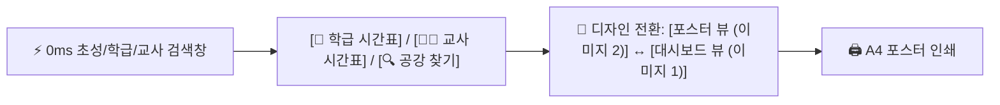

# 🎨 레퍼런스 디자인 통합(웹 대시보드 뷰 + 포스터/인쇄 뷰) 초고속 시간표 검색 웹앱 계획서

- **작성 일시 (KST)**: 2026-10-31 23:33
- **대상 프로젝트**: `c:\Users\user\Desktop\appsscript\25-timetable`
- **핵심 목표**:
  1. **속도 최우선 (0ms 체감 검색)**: 브라우저 인메모리 해시 인덱싱(`Map`) + `localStorage` 즉시 부팅 + 서버 `CacheService` 결합으로 검색 지연 시간 완전 제거
  2. **2종의 첨부 레퍼런스 디자인 완벽 제공 (실시간 테마 전환 & 인쇄 연동)**:
     - **테마 A (포스터 / 학급 게시용 에디토리얼 스타일 - 두 번째 첨부 이미지)**: 상단 슬로건 블랙 배너, 굵은 타이포그래피 헤더(`2026학년도 1학기 시간표`), 더블 스파클(`✦✦`) 그래픽, 우측 학교·학년반·담임 정보, 라임 옐로우(`#EEFC79`) 교시 열 & 쿨 그레이 요일 헤더
     - **테마 B (모던 대시보드 스타일 - 첫 번째 첨부 이미지)**: 다크 차콜 & 골드 요일 헤더(`#18181B` / `#FACC15`), 이동수업 라벤더(`#EDE9FE`), 오늘 요일 웜 크림(`#FEFCE8`), 보강·교체·이동 상태 배지 및 하단 범례 바

---

## 1. 🖼️ 두 번째 첨부 이미지(에디토리얼 포스터 스타일) 정밀 분석 및 반영 설계

새로 첨부해주신 이미지의 감각적인 타이포그래피와 컬러 포인트를 CSS/SVG로 100% 동일하게 구현합니다.

### ① 상단 슬로건 배너 (Top Black Banner)
- **배경 및 정렬**: 솔리드 블랙(`#0A0A0A`) 풀와이드 상단 바, 높이 `38px`, 중앙 정렬
- **텍스트**: `"지치지 않는 열정, 함께 만드는 우리들의 기록"` (화이트 `#FFFFFF`, `13px`, 자간 `-0.02em`, 웹앱에서 클릭 시 문구 커스텀 편집 가능)

### ② 에디토리얼 타이틀 섹션 (Editorial Header)
- **상단 행 (1단 가로선 위)**:
  - 좌측: **`2026학년도`** (레귤러/미디엄 웨이트 `400~500`, `42px`, `#111111`, 타이트한 자간)
  - 우측: **트윈 4각 별(Sparkle) 아이콘 `✦✦`** — 첫 번째 별은 **라임 옐로우(`#EEFC79`) 채우기 + 블랙 테두리(`2px`)**, 두 번째 별은 **솔리드 블랙(`#111111`) 채우기**를 인라인 SVG로 정교하게 제작
- **구분선 1**: 굵고 선명한 수평 실선 (`border-bottom: 2px solid #222222`)
- **하단 행 (2단 가로선 위)**:
  - 좌측: **`1학기 시간표`** (또는 선택 시 `교사 시간표`, 엑스트라 볼드 `800`, `44px`, `#111111`)
  - 우측 (우측 정렬 2줄 메타 정보):
    - 1줄: **`미리고등학교 2학년 3반`** (교사 조회 시 **`미리고등학교 국어과`** 등 소속 표시, `16px`, `font-weight: 500`, `#222222`)
    - 2줄: **`담임 | 김미리`** (교사 조회 시 **`교사 | 김미리`**, `16px`, `font-weight: 700`, `#111111`)
- **구분선 2**: 하단 수평 실선 (`border-bottom: 2px solid #222222`)

### ③ 시간표 테이블 그리드 (Lime & Crisp Grid)
- **테두리**: 외곽 및 모든 셀에 선명한 다크 그레이/블랙 실선 (`1.5px solid #4B5563`)
- **요일 헤더 행 (`월요일` ~ `금요일`)**:
  - 배경색: 쿨 라이트 그레이 (`#EFEFEF`)
  - 텍스트: `월요일`, `화요일`, `수요일`, `목요일`, `금요일` (`15px`, `font-weight: 700`, `#222222`)
- **좌측 교시 열 (`1교시` ~ `7교시`)**:
  - 배경색: 시그니처 **네온 라임 옐로우 (`#EEFC79` ~ `#EBF978`)**
  - 텍스트: `1교시` ~ `7교시` (`15px`, `font-weight: 800`, `#111111`), 옵션으로 시작 시각(`08:20` 등) 함께 표시 가능
- **과목 / 수업 셀**:
  - 배경색: 깔끔한 화이트 (`#FAFAFA` ~ `#FFFFFF`), 이동수업/보강 하이라이트 옵션 토글 가능
  - 텍스트: 중앙 정렬, 과목명 (`15px`, `font-weight: 600`, `#222222`), 부가 정보(`(동아리)`, `(학급회의)` 또는 담당 교사명/학급명)는 줄바꿈하여 `12.5px`로 깔끔하게 병기

---

## 2. 🔄 두 가지 디자인 테마 원클릭 스위처 & 초고속 검색 바

사용자가 상황에 맞게 두 이미지의 장점을 모두 누릴 수 있도록 **상단 플로팅 검색/컨트롤 바**(인쇄 시 자동 숨김 `@media print`)를 구성합니다.

### ① 제공 뷰 모드
1. **🎨 포스터 테마 (기본값 - 두 번째 첨부 이미지 스타일)**
   - 교실 게시판 부착용, 학급/교사 시간표 A4 출력용, 직관적이고 깔끔한 타이포그래피 중심 화면
2. **📊 대시보드 테마 (첫 번째 첨부 이미지 스타일)**
   - 다크/골드 헤더, 교시별 시작 시각(`08:20`~`15:10`), 이동수업(연보라 `#EDE9FE`)·금일 요일(웜옐로우 `#FEFCE8`)·창체(그레이 `#F3F4F6`) 색상 구분 및 하단 범례(`보강`/`교체`/`이동`) 중심의 실무용 화면

### ② 속도 최우선 (0ms Instant Search) 아키텍처 유지
- **서버 왕복 0회**: 앱 최초 로드 시 전체 교사·학급 시간표 데이터를 인라인 JSON 및 `localStorage`로 즉시 적재하고 브라우저 `Map` 해시 인덱스를 생성합니다.
- **초성 & 단축 검색**:
  - `2-3` 또는 `203` 입력 → **0ms** 만에 `2학년 3반 (담임 | 김미리)` 시간표로 즉시 교체
  - `ㄱㅁㄹ` 또는 `김미리` 입력 → **0ms** 만에 `김미리` 교사 개인 시간표로 즉시 교체
- **셀 클릭 양방향 점프 (Cross-Link)**:
  - 학급 시간표에서 특정 교시 과목(교사) 클릭 시 해당 교사 시간표로 즉시 이동, 교사 시간표에서 학급 클릭 시 해당 학급 시간표로 즉시 이동!

---

## 3. 📁 파일별 구현 계획

| 파일명 | 주요 구현 내용 |
| :--- | :--- |
| **`Code.gs`** | • `doGet(e)`: HTML 템플릿 렌더링 및 `CacheService` 초기 JSON 데이터 인라인 주입 (`window.__INITIAL_DATA__`) • `getTimetableData(forceRefresh)`: 6시간 메모리 캐시(`CacheService`) + 스프레드시트 `getValues()` 단 1회 일괄 읽기 파서 • `parseTimetableSheet_(ss)`: 학교명, 학년도/학기, 학급별 담임교사, 교사별 담당과목, 요일·교시별 수업/이동수업/상태 배지 자동 정규화 • `initSampleSheet()`: 두 첨부 이미지의 데이터(`2학년 3반 담임 김미리` 시간표 및 `한지탐/변윤*`, `미적분I/천나*` 등 교사·학급 데이터)를 스프레드시트에 자동 생성하는 함수 |
| **`index.html`** | • **Dual-Theme CSS**:    - **포스터 테마(이미지 2)**: 상단 슬로건 바, `2099학년도 1학기 시간표` 대형 헤더, `✦✦` SVG 스파클, `#EEFC79` 라임 교시 열, `#EFEFEF` 요일 헤더, A4 1페이지 딱맞춤 `@media print` 인쇄 스타일   - **대시보드 테마(이미지 1)**: `#18181B` 다크 헤더 + `#FACC15` 골드 요일, `#EDE9FE` 이동수업 라벤더, `#FEFCE8` 오늘 요일 크림 옐로우, 하단 범례 바 • **0ms 초성 검색 & 렌더링 엔진**: 한글 초성 분해 매칭(`ㄱ~ㅎ`), `localStorage` 즉시 부팅, 교사명 마스킹(`변윤*`) 토글, 학년도/학교명/슬로건 인라인 편집 지원 |

---

## 4. 🧪 검증 계획 (Rule 2 준수)

- 코드 작성 후 `Code.gs`와 `index.html` 인라인 스크립트에 대해 `node --check` 정적 구문 검사를 수행하여 문법 오류 0건을 확인합니다.
- `/ask` 모드 정책에 따라 현재 코드는 수정하지 않았으며, **`/apply`**를 입력해주시면 두 이미지의 디자인과 초고속 검색 엔진을 즉시 구현하겠습니다!

